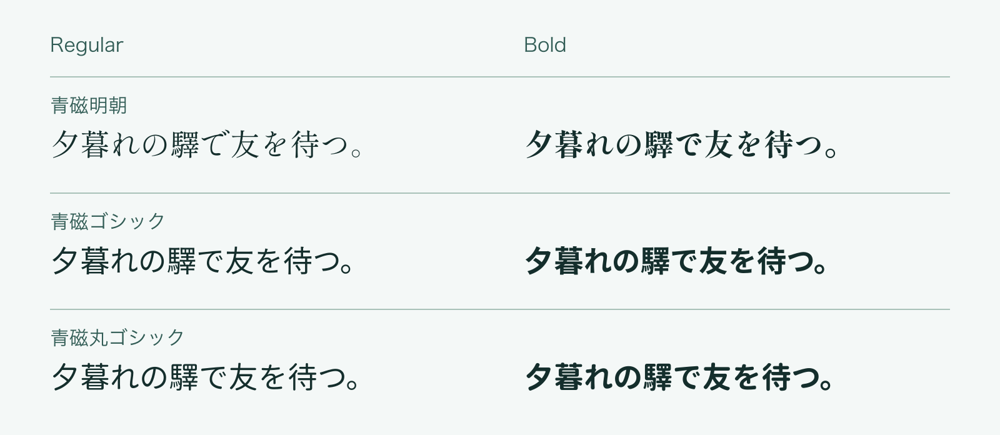

# Seiji / 青磁

[日本語](README.md)

Seiji is a family of Japanese typefaces for setting text in traditional kanji forms. Seiji Mincho, Seiji Gothic, and Seiji Maru Gothic each come in Regular and Bold.

[Download the fonts](https://github.com/metasta/seiji-fonts/releases)

[Nakaya Ukichirō, Hachigatsu mikka no yume](https://www.aozora.gr.jp/cards/001569/files/59201_68743.html)

## Installation

Extract the release ZIP and install the OTF files for the typeface and weight you want. Install both OTF files if you use both Regular and Bold. Choose the family from your app’s font menu.

| English family name | Japanese family name | PostScript name (Regular) | PostScript name (Bold) |
| --- | --- | --- | --- |
| Seiji Mincho | 青磁明朝 | `SeijiMincho-Regular` | `SeijiMincho-Bold` |
| Seiji Gothic | 青磁ゴシック | `SeijiGothic-Regular` | `SeijiGothic-Bold` |
| Seiji Maru Gothic | 青磁丸ゴシック | `SeijiMaruGothic-Regular` | `SeijiMaruGothic-Bold` |

### Web browsers

Set Seiji as your browser’s default font to use it wherever a site relies on that default. In browsers without a default font picker, such as Safari on macOS, a user style sheet may let you apply the font.

The Seiji release ZIP includes CSS for Japanese page content. The guide explains how to apply it and which parts of a page it affects. [Safari setup and scope (Japanese)](docs/safari.md)

[Chrome settings](https://support.google.com/chrome/answer/96810?hl=en) · [Firefox settings](https://support.mozilla.org/en-US/kb/change-fonts-and-colors-websites-use) · [Safari settings](https://support.apple.com/en-ie/guide/safari/ibrw1075/mac) · [WebKit’s tracking prevention](https://webkit.org/tracking-prevention/)

## Kanji coverage and glyph selection

The 0.300 preview includes 1,026 educational kanji and 400 additional jōyō kanji, for a total of 1,426 across all six fonts. The release ZIP includes the complete list in `収録漢字.txt`.

Kanji forms follow the criteria of I.Ming Seiji v1.1, which consider character origins and Japanese usage. The glyphs for the Mincho, Gothic, and Maru Gothic designs are selected from their respective source fonts. [I.Ming Seiji selection criteria](https://github.com/epistularum/kanji-restoration#正字-criteria) · [Kanji selection and adjustments (Japanese)](docs/glyph-selection.md)

## Distinguishing kanji that share a modern form

### Selecting forms with ideographic variation sequences

餘 (“remainder”) and 余 (a first-person pronoun) are distinct kanji that share the form 余 in modern Japanese. Seiji displays 余 as 餘 by default. To display the form 余 in an app that supports ideographic variation sequences (IVS), enter `余󠄀` (余, U+4F59, followed by variation selector U+E0100). The same selector specifies the first-person form 予 in `予󠄀`. This option covers 13 kanji in Seiji 0.300, including 余, 予, 灯, and 芸.

### Selecting forms automatically from context

辯, 辨, and 瓣 are distinct kanji that share the form 弁 in modern Japanese. 弁論 appears as 辯論 by default. With the OpenType `calt` feature enabled, 弁別 and 花弁 appear as 辨別 and 花瓣, respectively. The contextual rules in Seiji 0.300 cover seven kanji, including 弁, 芸, 台, and 欠.

These rules apply to the character sequences registered in the font. A line break within a sequence can prevent a rule from applying, even when the app inserts the break automatically.

To get the intended forms regardless of line breaks, enter a supported kanji directly or specify the form with a supported IVS. Seiji 0.300 displays forms such as 辯, 辨, and 瓣 from 弁. The corresponding code points are outside that version’s coverage. The release ZIP lists the kanji you can enter directly in `収録漢字.txt`. [Contextual rules and IVS reference (Japanese)](docs/contextual-forms.md)

## Technical documentation

These documents are in Japanese.

- [Kanji and kana coverage](docs/coverage.md)
- [Kanji selection and Seiji’s glyph design](docs/glyph-selection.md)
- [Contextual forms and ideographic variation sequences](docs/contextual-forms.md)
- [Safari setup and style sheet scope](docs/safari.md)
- [Known display limitations](docs/known-issues.md)

## License and sources

Seiji is distributed under the SIL Open Font License 1.1, including the fonts embedded in the Safari CSS. See `OFL.txt` for copyright notices and the license text. The release ZIP lists source URLs and SHA-256 hashes in `素材の出典.json`. [OFL.txt](OFL.txt)

Questions and bug reports are welcome on GitHub. [Issues](https://github.com/metasta/seiji-fonts/issues)
