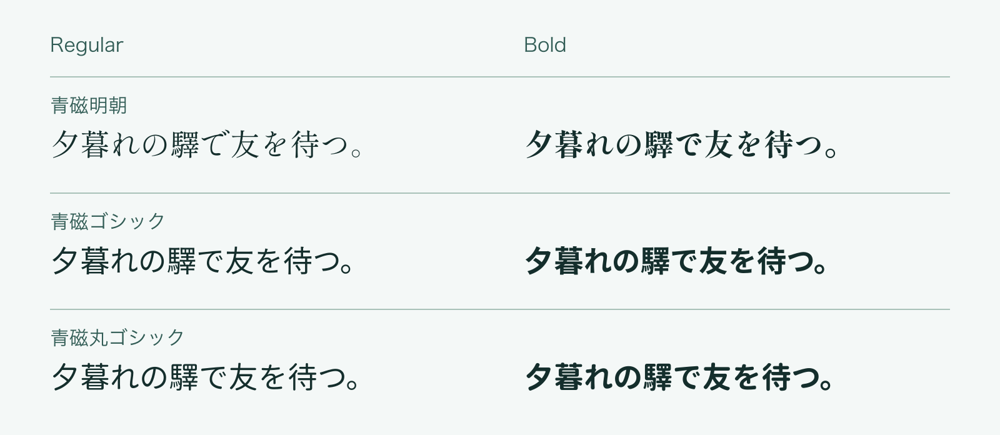

# 青磁 / Seiji

[English](README.en.md)

青磁（せいじ）は、日本語を正字で組むための書体です。青磁明朝・青磁ゴシック・青磁丸ゴシックに、それぞれRegularとBoldがあります。

[フォントをダウンロード](https://github.com/metasta/seiji-fonts/releases)

[中谷宇吉郎『八月三日の夢』](https://www.aozora.gr.jp/cards/001569/files/59201_68743.html)

## 利用方法

配布ZIPを展開し、利用する書体とウェイトのOTFをインストールします。RegularとBoldを併用する場合は、両方のOTFをインストールします。アプリのフォントメニューで、表のファミリー名を選びます。

| ファミリー名（日本語） | ファミリー名（英語） | PostScript名（Regular） | PostScript名（Bold） |
| --- | --- | --- | --- |
| 青磁明朝 | Seiji Mincho | `SeijiMincho-Regular` | `SeijiMincho-Bold` |
| 青磁ゴシック | Seiji Gothic | `SeijiGothic-Regular` | `SeijiGothic-Bold` |
| 青磁丸ゴシック | Seiji Maru Gothic | `SeijiMaruGothic-Regular` | `SeijiMaruGothic-Bold` |

### Webブラウザ

Webブラウザの既定フォントに青磁を指定すると、サイト側が既定フォントに任せた箇所を青磁で表示できます。macOS版Safariなど既定フォントを選ぶ設定がない一部のブラウザでは、ユーザースタイルシートを指定することで表示できる場合があります。

青磁の配布ZIPには、対象の日本語ページを青磁で表示するためのCSSが含まれます。設定手順と適用範囲は、Safari向けの案内を参照してください。 [Safariでの設定と適用範囲](docs/safari.md)

[Chromeの設定](https://support.google.com/chrome/answer/96810?hl=ja)・[Firefoxの設定](https://support.mozilla.org/ja/kb/change-fonts-and-colors-websites-use)・[Safariの詳細設定](https://support.apple.com/en-ie/guide/safari/ibrw1075/mac)・[WebKitのプライバシー保護](https://webkit.org/tracking-prevention/)

## 収録範囲と字形の基準

増補先行版 0.300は、教育漢字1,026字と、教育漢字以外の常用漢字400字を収録します。6本のフォントに共通する計1,426字です。個々の漢字は、配布ZIPの `収録漢字.txt` で確認できます。

漢字の字形選定には、字の成り立ちと日本語での用法を確かめる一点明朝正字 v1.1 の基準を採用しました。その基準に沿って、明朝・ゴシック・丸ゴシックそれぞれの素材から字形を選びました。 [一点明朝正字の字形選定基準](https://github.com/epistularum/kanji-restoration#正字-criteria)・[青磁の字形の選定と調整](docs/glyph-selection.md)

## 複数の正字を持つ漢字への対応

### 異体字シーケンスで字形を指定する機能

「餘」（あまり）と「余」（わたし、一人称）は、今の表記では同じ「余」と書く別の漢字です。青磁では「余」を通常「餘」と表示します。異体字シーケンス（IVS）に対応する環境で `余󠄀`（「余」`U+4F59` の直後に異体字セレクタ `U+E0100`）と入力すると、「余」の字形を指定できます。一人称の「予」も、同じセレクタを付けた `予󠄀` で指定できます。青磁0.300では「余」「予」「灯」「芸」など計13字が対象です。

### 文脈に適した字形を自動選択する機能

「辯」「辨」「瓣」は、今の表記では同じ「弁」と書く別の漢字です。「弁論」は通常「辯論」と表示します。OpenTypeの `calt` が有効な環境では、「弁別」「花弁」をそれぞれ「辨別」「花瓣」と表示します。青磁0.300では「弁」「芸」「台」「欠」など計7字に文脈規則があります。

`calt` 機能はフォント内の文脈辞書に登録された語彙についてのみ働きます。また、文脈の途中で改行されるなど表示が分割されると `calt` が適用されないことがあります。

改行の影響を避けるには、収録済みの漢字を直接入力するか、対応するIVSで字形を指定します。青磁0.300では、「辯」「辨」「瓣」など、表示できる字形の一部が直接入力の対象外です。直接入力できる漢字は、配布ZIPの `収録漢字.txt` で確認できます。 [文脈規則とIVSの対応表](docs/contextual-forms.md)

## 技術資料

- [漢字とかなの収録範囲](docs/coverage.md)
- [漢字の選定基準と青磁の字形](docs/glyph-selection.md)
- [文脈による字形選択と異体字シーケンス](docs/contextual-forms.md)
- [macOS版Safariでの設定と適用範囲](docs/safari.md)
- [既知の表示上の制約](docs/known-issues.md)

## 使用許諾と素材

OTF版のフォントとSafari用CSS内のフォントは、SIL Open Font License 1.1で配布します。著作権表示とライセンス原文は `OFL.txt` に、素材の配布元とSHA-256は配布ZIPの `素材の出典.json` に記載します。 [OFL.txt](OFL.txt)

青磁に関する質問や不具合の報告は、GitHub Issuesで受け付けます。 [Issues](https://github.com/metasta/seiji-fonts/issues)
